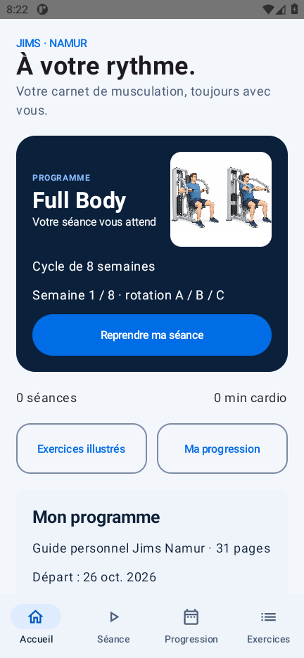
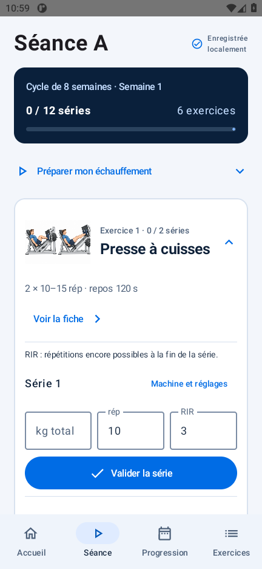

# Mon Coach Sport — Android 0.4.0

Application Android native personnelle en français : Kotlin, Compose Material 3, Navigation Compose, MVVM, coroutines/Flow, Room et DataStore. Hors ligne, sans compte, publicité ni télémétrie. Aucune permission Internet. Android 8.0 minimum (API 26), compilation/cible API 36.

## But du projet

Mon Coach Sport accompagne les séances de musculation Full Body : retrouver la bonne fiche, noter les séries et les réglages, respecter les temps de repos et consulter sa progression. Le programme personnel et les données restent disponibles sans connexion, directement sur le téléphone.

Le dépôt `full-body` regroupe le code Android, les tests, les ressources du guide et la documentation de développement. Il ne contient ni historique personnel d’entraînement, ni outils Android locaux, ni clés de signature.

## Aperçu

Pour tester l’application : [télécharger l’APK 0.4.0 dans les versions GitHub](https://github.com/raphaelmounirprivate-dot/full-body/releases/tag/v0.4.0). Il s’agit d’une version debug destinée aux essais locaux, pour Android 8.0 ou plus récent. Le dépôt et ses téléchargements sont privés.

| Accueil | Séance | Fiche d’exercice |
| --- | --- | --- |
|  |  |  |

Voir aussi [l’aperçu compact de la séance](docs/screenshots/seance-apercu.png) et [la séance en grande police](docs/screenshots/seance-grande-police.png). Validation de cette version : [résultats 0.4.0](docs/validation-0.4.0.md).

## Développement

Le projet est développé par étapes, en conservant les séances existantes et leurs paramètres. Voir [le développement et l’architecture](docs/DEVELOPPEMENT.md) et [l’historique des versions](CHANGELOG.md).

## Fonctionnalités

- Séance guidée avec avancement des séries, illustrations, exercices dépliables et une série proposée à la fois. Les séries enregistrées se résument sur une ligne et restent modifiables ; les brouillons sont conservés quand on replie un exercice.
- Bouton « Voir la fiche » sur chaque exercice de la séance et du catalogue, y compris les options sautées : illustration agrandissable et consignes dans une fenêtre défilante. Fermer la fiche conserve les saisies.
- Cycle de huit semaines : A/B/C, deux séries, plages de répétitions/repos propres à chaque séance, exercices facultatifs, repères cardio et RIR.
- Deux programmes séparés : les anciennes séances gardent le programme illustré initial. Programme, semaine et options sont enregistrés dans chaque séance.
- Semaine calculée en dates locales, sans décalage lors du changement d’heure. Date de départ réglable pour les prochaines séances.
- Remplacements conditionnels du guide disponibles ; aucun ajout automatique.
- Options sautables ; troisième série facultative sur les trois premiers mouvements en S5–6. En S7–8, conservation des choix du dernier passage correspondant pour stabiliser le volume. Les séries validées ne sont pas supprimées par le retrait d’une option.
- Kg total ou par côté, réglages, notes, RIR et brouillons persistés. Dernier passage filtré sur exercice, programme, machine et unité.
- Hausse de charge suggérée seulement après deux passages consécutifs complets au haut de la plage, avec réserve prévue et charge/unité/machine/réglages identiques. Aucune hausse automatique.
- Repos manuel ou automatique après écriture réussie, pause/reprise, notification locale facultative et retour haptique configurable.
- Historique, courbes de charges et répétitions/secondes, résumé sur sept jours, bilans hebdomadaires de récupération.
- Export/import JSON et CSV validés, sauvegardes locales et suppression confirmée de l’historique ou de toutes les données/préférences.

## Référence corrigée et présentation

Le document de référence est `Programme_Jims_Namur_images_uniformisees.pdf` : 31 pages, édition illustrée harmonisée du 25 octobre 2026. Le PDF original est embarqué sans modification dans `app/src/main/assets/guide/`. Son empreinte et les correspondances page/exercice/image sont dans `docs/guide-source-mapping.json`.

Les 19 images sont extraites des pages 9–27 à leur cadrage d’origine puis adaptées en WebP. Noms, muscles, légendes, Installer/Bouger/Vérifier et mises en garde sont transcrits depuis chaque fiche. Les légendes du leg curl (schéma du geste, pas une notice de machine) et de la planche (deux variantes, pas deux phases) sont conservées. Le guide personnel précise que ses dessins sont générés et qu’il ne s’agit pas d’un document officiel du club.

Les règles générales des pages 1–3, le cardio p. 7, les remplacements p. 8 et le bilan p. 31 sont consultables dans l’application. Le PDF complet est enregistrable depuis le bouton situé en bas de l’accueil. Le bloc « À propos du guide » a été retiré en version 0.3.1. Le RIR 3–4 en S1–2 puis environ 2–3 est confirmé par la page 2.

Remplacements : F7/F8, presse ou leg extension dans le premier emplacement de B ; rowing assis au lieu du rowing avec appui ; développé incliné F10 en B ; écarté F16 en C ; crunch F19 à la place de la planche. Les conditions et les plages spécifiques sont affichées. Chaque remplacement prend un seul emplacement. Le leg extension ne remplace pas le leg curl. Pour une substitution sans plage différente chiffrée, les paramètres de l’emplacement remplacé sont conservés. La planche ne suggère jamais de hausse de charge.

L’ancien PDF de 8 pages et ses images servent uniquement à relire les anciennes séances. Programme, semaine, valeurs, unités et données ne sont pas effacés ni convertis. Les nouvelles séances se réfèrent au bon guide, y compris après restauration d’une ancienne sauvegarde.

Le visuel s’inspire de la maquette FITPRO fournie : bleu vif/bleu nuit, carte Full Body, raccourcis, catalogue compact avec vignettes et filtres musculaires, fiches illustrées plus larges. Les images proviennent du guide ; aucun contenu anatomique supplémentaire n’est inventé.

Contrôle : `python scripts/verify_guide.py`. Réimport : `python scripts/import_guide.py --source <chemin-du-guide>` avec pypdf, pypdfium2 et Pillow.


## Conservation et sauvegardes

Room v2 ajoute les bilans par migration explicite 1→2 et préserve la table des séances. Les anciens JSON sans identifiant de programme restent associés au programme initial. Aucun effacement destructif automatique.

Écritures asynchrones : les dernières frappes peuvent être perdues si l’arrêt intervient pendant une écriture. Le minuteur conserve son échéance ; Android peut retarder les notifications en veille. Alarme non exacte, non réinstallée après redémarrage complet du téléphone.

- JSON v2 : séances, bilans, date de départ, programme et préférences d’interface. JSON v1 accepté. Autorisation de notification liée au téléphone.
- CSV v0.2 : historique restaurable avec colonnes lisibles et état JSON conservant options/brouillons. Validation des guillemets, séparateurs, retours à la ligne, unités et cohérence. L’import conserve les bilans/préférences actuels.
- Les CSV de consultation v0.1 et d’autres applications sont refusés car leur schéma diffère.
- Confirmation et validation complète avant remplacement transactionnel dans Room. Une seule séance en cours par sauvegarde.

## Compiler et tester

Versions testées : JDK 17, Gradle 8.13, AGP 8.11.1, Kotlin/Compose compiler 2.2.20, KSP 2.2.20-2.0.3, BOM Compose 2025.08.01, Room 2.7.2, DataStore 1.1.7. Elles ne sont pas présentées comme les dernières sorties.

Ouvrir dans Android Studio avec SDK Platform 36, Build Tools requis par AGP et JDK 17. Sur ce poste, outils isolés dans `.tools` :

```powershell
./scripts/build.ps1
./scripts/build.ps1 -Tasks ':app:assembleDebugAndroidTest', ':app:bundleRelease'
./scripts/test-device.ps1 -DeviceId emulator-5554
```

**Utiliser un émulateur de test : les tests effacent les données de cette application sur l’appareil choisi.** Le lanceur Gradle UTP échoue dans cet environnement Windows sandboxé ; exécution directe avec `adb shell am instrument -w`.

APK : `app/build/outputs/apk/debug/app-debug.apk`. AAB non signé : `app/build/outputs/bundle/release/app-release.aab`. Signature release à fournir par le propriétaire. Aucun secret/certificat release inclus.

Installer l’APK par-dessus la précédente avec `adb install -r` pour conserver les données et exécuter la migration ; ne pas désinstaller l’ancienne application.

Livrables : `output/`, avec empreintes SHA-256. L’archive source inclut code, tests, documents et captures, sans outils/caches. Livrables précédents dans `output/v0.1.0/`.

Preuves : `docs/validation.md` et `docs/test-results/`. Tests : `python scripts/verify_content.py` et `python scripts/verify_guide.py`. Réimport du guide corrigé : `python scripts/import_guide.py` ; l’importateur `scripts/import_programme.py` est réservé à l’archive historique de 8 pages. Dépendances : pypdf, pypdfium2 et Pillow. Aucun remplacement de source nécessaire pour compiler.

Restent à valider sur téléphone physique : permission Android 13+, veille prolongée et particularités des constructeurs. Aucune validation sportive ou médicale du programme n’est revendiquée.
