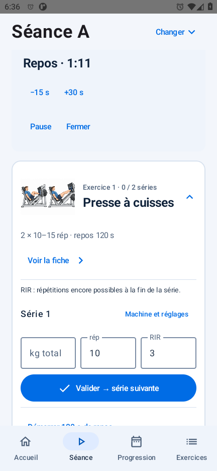
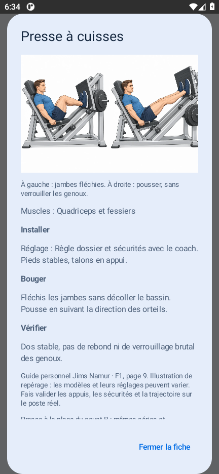
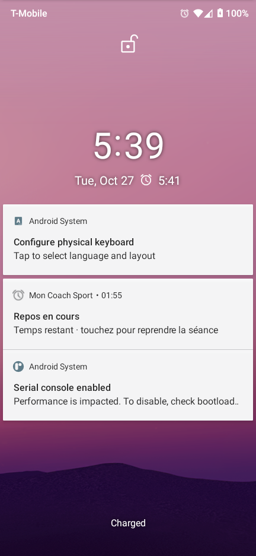
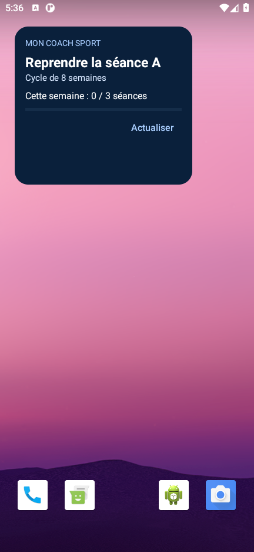

# Mon Coach Sport — Android 0.8.0

Application Android native personnelle en français : Kotlin, Compose Material 3, Navigation Compose, MVVM, coroutines/Flow, Room et DataStore. Hors ligne, sans compte, publicité ni télémétrie. Aucune permission Internet. Android 8.0 minimum (API 26), compilation/cible API 36.

## But du projet

Mon Coach Sport accompagne les séances de musculation Full Body : retrouver la bonne fiche, noter les séries et les réglages, respecter les temps de repos et consulter sa progression. Le programme personnel et les données restent disponibles sans connexion, directement sur le téléphone.

Le dépôt `full-body` regroupe le code Android, les tests, les ressources du guide et la documentation de développement. Il ne contient ni historique personnel d’entraînement, ni outils Android locaux, ni clés de signature.

## Aperçu

Pour tester l’application : [télécharger l’APK optimisé 0.8.0 dans les versions GitHub](https://github.com/raphaelmounirprivate-dot/full-body/releases/tag/v0.8.0). Il utilise la même clé de test que les versions précédentes et peut être installé par-dessus sans désinstallation. Faire une sauvegarde JSON avant mise à jour. Android 8.0 minimum. Le dépôt et ses téléchargements sont privés ; aucune signature de distribution commerciale n’est fournie.

| Accueil | Séance et repos | Fiche d’exercice |
| --- | --- | --- |
|  |  |  |

Captures de l’APK optimisé 0.8.0 sur l’émulateur Android 11, avec des données de démonstration.

| Notification sur écran verrouillé | Widget sur l’accueil Android |
| --- | --- |
|  |  |

État détaillé des fonctions : [suivi et tâches restantes](docs/ROADMAP.md). Validation et captures en grande police : [résultats 0.8.0](docs/validation-0.8.0.md).

## Développement

Le projet est développé par étapes, en conservant les séances existantes et leurs paramètres. Voir [le développement et l’architecture](docs/DEVELOPPEMENT.md) et [l’historique des versions](CHANGELOG.md).

## Fonctionnalités

- Pendant le repos, notification silencieuse avec décompte natif Android, visible sur l’écran verrouillé selon les réglages système. Activer « Notification et vibration » dans l’accueil ; le compteur ne dépend pas d’une boucle qui réveille l’application chaque seconde.
- Minuteur : +30 s / −15 s, aussi en pause. À zéro : « Repos terminé ✓ », puis fermeture après trois secondes visibles ; vibration si les rappels sont activés et l’application visible, sans double signal.
- Records personnels : badge de charge, de répétitions à charge identique ou de durée. Renseigner « Machine et réglages » : les comparaisons restent séparées par programme, exercice, machine, réglages et unité. Premier passage sans badge ; aucun record annoncé avec un historique illisible. Aucun changement de charge automatique.
- Vrai widget sur l’accueil Android : séance à reprendre ou prochaine séance A/B/C, objectif hebdomadaire et bouton Actualiser. Depuis l’accueil de l’application, « Ajouter le widget Android », ou appui long sur l’accueil du téléphone → Widgets → Mon Coach Sport. Il s’agit d’un widget distinct des cartes internes réorganisables.

- Rappel de repos précis si autorisé dans Android, repli non exact sinon ; événements annulés ou périmés ignorés, réarmement des échéances futures après redémarrage et mise à jour. Activer « Notification et vibration », puis « Autoriser les rappels précis » si proposé.
- Écran maintenu allumé pendant une séance active, réglable depuis « Confort pendant la séance ». Le verrouillage manuel reste possible.
- Option « Enchaînement guidé » sur l’écran de séance : prochaine série après validation enregistrée, exercice suivant puis bilan. Le mode complet reste accessible pour corriger ou terminer plus tôt.
- Poids et masse grasse : « Progression » → « Mes mesures et mes courbes ». Une mesure par date, modifiable ; valeurs manuelles, facultatives, courbes et historique.
- Rappel facultatif de fin du cycle ; niveau de profil et repère personnel par exercice, sans transformation du guide.
- Lien YouTube personnel pour chaque fiche, distinct selon le programme. Neuf démonstrations par défaut sont documentées dans [les sources vidéo](docs/video-sources.md) ; les autres fiches proposent une recherche explicitement nommée. YouTube s’ouvre à l’extérieur et nécessite Internet.
- « Organiser mon accueil » permet de déplacer ou masquer les cartes statistiques, raccourcis, dernier entraînement et objectif.
- Objectif hebdomadaire à points facultatif : 10 points par séance terminée, sans classement ni récompense liée aux charges. Les challenges de course et meilleur score restent dans la feuille de route.

- Une séance locale illisible est mise de côté et signalée sans bloquer les autres. L’export JSON conserve également les lignes brutes pour permettre leur récupération ; elles ne sont jamais supprimées automatiquement.
- Les brouillons sont enregistrés champ par champ ; les lignes d’historique inchangées ne sont pas redécodées. Le minuteur dispose de son propre composant d’affichage.
- Après huit semaines calendaires, « Recommencer en semaine 1 » propose un nouveau départ en conservant l’historique. Les séances du cycle encore en cours ou en pause doivent d’abord être terminées.
- Choix direct A/B/C : toucher « Changer » à côté du titre de séance, puis choisir le type souhaité. La séance quittée reste en pause ; revenir dessus reprend ses séries, sa semaine, ses réglages et ses saisies. Le repos en cours est arrêté. Sans séance en cours, « Choisir A, B ou C » permet de commencer librement. La rotation proposée suit la dernière séance réellement terminée.
- Séance guidée avec avancement des séries, illustrations, exercices dépliables et une série proposée à la fois. Les séries enregistrées se résument sur une ligne et restent modifiables ; les brouillons sont conservés quand on replie un exercice.
- Bouton « Voir la fiche » sur chaque exercice de la séance et du catalogue, y compris les options sautées : illustration agrandissable et consignes dans une fenêtre défilante. Fermer la fiche conserve les saisies.
- Cycle de huit semaines : A/B/C, deux séries, plages de répétitions/repos propres à chaque séance, exercices facultatifs, repères cardio et RIR.
- Deux programmes séparés : les anciennes séances gardent le programme illustré initial. Programme, semaine et options sont enregistrés dans chaque séance.
- Semaine calculée en dates locales, sans décalage lors du changement d’heure. Date de départ réglable pour les prochaines séances.
- Remplacements conditionnels du guide disponibles ; aucun ajout automatique.
- Options sautables ; troisième série facultative sur les trois premiers mouvements en S5–6. En S7–8, conservation des choix du dernier passage correspondant pour stabiliser le volume. Les séries validées ne sont pas supprimées par le retrait d’une option.
- Kg total ou par côté, réglages, notes, RIR et brouillons persistés. Dernier passage filtré sur exercice, programme, machine et unité.
- Hausse de charge suggérée seulement après deux passages consécutifs complets au haut de la plage, avec réserve prévue et charge/unité/machine/réglages identiques. Aucune hausse automatique.
- Repos manuel ou automatique après écriture réussie, pause/reprise, notification locale facultative et retour haptique configurable.
- Historique, courbes de charges et répétitions/secondes, résumé sur sept jours, bilans hebdomadaires de récupération.
- Export/import JSON et CSV validés, sauvegardes locales et suppression confirmée de l’historique ou de toutes les données/préférences.

## Référence corrigée et présentation

Le document de référence est `Programme_Jims_Namur_images_uniformisees.pdf` : 31 pages, édition illustrée harmonisée du 25 octobre 2026. Les deux PDF originaux sont conservés dans `docs/sources/`, hors APK. L’application embarque des copies mobiles dont les images sont compressées, avec les mêmes textes, pages et dimensions. Empreintes et tailles : `docs/asset-optimization.json` ; correspondances du guide original : `docs/guide-source-mapping.json`. Le guide mobile passe de 43,7 Mo à environ 2,5 Mo.

Les 19 images sont extraites des pages 9–27 à leur cadrage d’origine puis adaptées en WebP. Noms, muscles, légendes, Installer/Bouger/Vérifier et mises en garde sont transcrits depuis chaque fiche. Les légendes du leg curl (schéma du geste, pas une notice de machine) et de la planche (deux variantes, pas deux phases) sont conservées. Le guide personnel précise que ses dessins sont générés et qu’il ne s’agit pas d’un document officiel du club.

Les règles générales des pages 1–3, le cardio p. 7, les remplacements p. 8 et le bilan p. 31 sont consultables dans l’application. Le PDF complet est enregistrable depuis le bouton situé en bas de l’accueil. Le bloc « À propos du guide » a été retiré en version 0.3.1. Le RIR 3–4 en S1–2 puis environ 2–3 est confirmé par la page 2.

Remplacements : F7/F8, presse ou leg extension dans le premier emplacement de B ; rowing assis au lieu du rowing avec appui ; développé incliné F10 en B ; écarté F16 en C ; crunch F19 à la place de la planche. Les conditions et les plages spécifiques sont affichées. Chaque remplacement prend un seul emplacement. Le leg extension ne remplace pas le leg curl. Pour une substitution sans plage différente chiffrée, les paramètres de l’emplacement remplacé sont conservés. La planche ne suggère jamais de hausse de charge.

L’ancien PDF de 8 pages et ses images servent uniquement à relire les anciennes séances. Programme, semaine, valeurs, unités et données ne sont pas effacés ni convertis. Les nouvelles séances se réfèrent au bon guide, y compris après restauration d’une ancienne sauvegarde.

Le visuel s’inspire de la maquette FITPRO fournie : bleu vif/bleu nuit, carte Full Body, raccourcis, catalogue compact avec vignettes et filtres musculaires, fiches illustrées plus larges. Les images proviennent du guide ; aucun contenu anatomique supplémentaire n’est inventé.

Contrôle : `python scripts/verify_guide.py`. Réimport : `python scripts/import_guide.py --source <chemin-du-guide>` avec pypdf, pypdfium2 et Pillow.


## Conservation et sauvegardes

Room v4 conserve les migrations 1→2 et 2→3 et ajoute 3→4 pour les mesures corporelles. Les brouillons déjà présents dans les anciens JSON restent lus ; aucune séance n’est réinterprétée. Les anciens JSON sans identifiant de programme restent associés au programme initial. Aucun effacement destructif automatique.

Écritures asynchrones : les dernières frappes peuvent être perdues si l’arrêt intervient pendant une écriture. Le minuteur conserve son échéance. Les alarmes exactes nécessitent l’autorisation Android correspondante à partir d’Android 12 ; sans elle, le rappel peut être retardé. Le repos précis utilise une alarme utilisateur visible dans Android pour éviter la limitation des alarmes ordinaires rapprochées en veille. Les échéances futures sont réarmées au redémarrage ; un repos déjà expiré n’est pas rejoué. Un arrêt forcé de l’application et les restrictions du constructeur peuvent empêcher les rappels.

- JSON format 5 : séances, bilans, préférences, mesures corporelles, organisation, niveaux et liens vidéo personnels. JSON formats 1, 2 et 3 acceptés. Une ancienne sauvegarde conserve les mesures/options nouvelles déjà présentes ; les autorisations restent propres au téléphone et le rappel de cycle n’est pas réactivé par restauration.
- En présence de lignes illisibles, l’export JSON utilise un format de récupération 4 et ajoute un bloc `recovery` avec les lignes et les brouillons bruts. Ce fichier doit être examiné et réparé avant import ; un import automatique est refusé sans remplacer les données locales. Le numéro 4 empêche aussi les anciens APK d’ignorer silencieusement ces lignes. Le CSV ne contient que les séances lisibles.
- CSV format 3 : historique des séances restaurable, sans mesures corporelles ni nouvelles préférences. Utiliser JSON 5 pour une sauvegarde complète. Les anciens exports CSV 2 restent importables ; l’import CSV conserve les mesures et préférences actuelles.
- Les CSV de consultation v0.1 et d’autres applications sont refusés car leur schéma diffère.
- Confirmation et validation complète avant remplacement transactionnel dans Room. Une seule séance active ; au plus une séance non terminée par programme et type A/B/C. Les séances en pause ne sont pas comptées comme terminées. Les anciens APK ne peuvent pas ouvrir directement une base Room v4 ni restaurer le JSON 5.

## Compiler et tester

Versions testées : JDK 17, Gradle 8.13, AGP 8.11.1, Kotlin/Compose compiler 2.2.20, KSP 2.2.20-2.0.3, BOM Compose 2025.08.01, Room 2.7.2, DataStore 1.1.7. Elles ne sont pas présentées comme les dernières sorties.

Ouvrir dans Android Studio avec SDK Platform 36, Build Tools requis par AGP et JDK 17. Sur ce poste, outils isolés dans `.tools` :

```powershell
./gradlew.bat :app:assembleDebug :app:testDebugUnitTest :app:lintDebug
./gradlew.bat :app:assembleDebugAndroidTest :app:assembleRelease :app:bundleRelease
./scripts/test-device.ps1 -DeviceId emulator-5556
```

**Utiliser un émulateur de test : les tests effacent les données de cette application sur l’appareil choisi.** Le lanceur Gradle UTP échoue dans cet environnement Windows sandboxé ; exécution directe avec `adb shell am instrument -w`.

APK debug : `app/build/outputs/apk/debug/app-debug.apk` (environ 16,8 Mo). APK optimisé non signé : `app/build/outputs/apk/release/app-release-unsigned.apk` (environ 6,8 Mo). R8 et la réduction des ressources sont activés pour release. AAB non signé : `app/build/outputs/bundle/release/app-release.aab`. L’APK optimisé téléchargeable est signé localement avec la clé de test déjà utilisée ; cette clé reste hors du dépôt. Une signature de distribution finale doit être fournie par le propriétaire.

Installer l’APK par-dessus la précédente avec `adb install -r` pour conserver les données et exécuter la migration ; ne pas désinstaller l’ancienne application.

Livrables : `output/`, avec empreintes SHA-256. L’archive source inclut code, tests, documents et captures, sans outils/caches. Livrables précédents dans `output/v0.1.0/`.

Preuves : `docs/validation-0.8.0.md` et `docs/test-results/`. La [CI Android](https://github.com/raphaelmounirprivate-dot/full-body/actions/workflows/android.yml) lance les tests JVM et lint à chaque push et pull request ; les tests sur émulateur restent exécutés localement. Tests de contenu : `python scripts/verify_content.py` et `python scripts/verify_guide.py`. Réimport du guide : `python scripts/import_guide.py`, puis `python scripts/optimize_assets.py` pour préparer les copies mobiles. `python scripts/verify_rendered_assets.py` compare le rendu des 39 pages. L’importateur `scripts/import_programme.py` est réservé à l’archive historique de 8 pages. Dépendances : pypdf, pypdfium2 et Pillow. Aucun remplacement de source nécessaire pour compiler.

Nettoyage : `python scripts/cleanup_artifacts.py` propose une simulation ; ajouter `--apply` pour retirer uniquement les archives d’outils déjà extraits et les anciens APK/AAB listés. Les sources des versions anciennes et les livrables 0.5.0 de retour arrière sont conservés. Rapport : `docs/local-cleanup.json`.

Restent à valider sur téléphone physique : permission Android 13+, veille prolongée et particularités des constructeurs. Aucune validation sportive ou médicale du programme n’est revendiquée.
